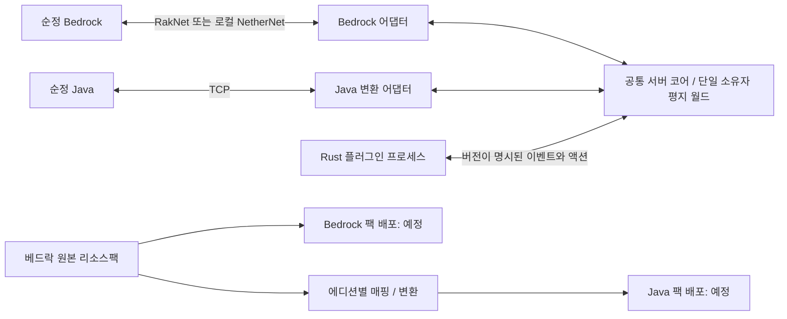

# 설계 기준

## 베드락을 기준으로 하는 단일 서버

Sculith의 기준은 베드락 콘텐츠와 게임 규칙입니다. Java와 Bedrock별로 월드를 따로 실행한 뒤
동기화하는 구조 대신, 하나의 월드 소유자에게 두 프로토콜 어댑터가 요청을 제출하는 구조입니다.
Java 사용자의 입력은 베드락 기준 동작으로 바꾸고, 결과는 자바 클라이언트가 표현할 수 있는 패킷으로 바꿉니다.

Java 어댑터는 서버 목록 조회까지 구현했습니다. Bedrock은 선택적으로 암호화 로그인·평지 스폰·제한된 크리에이티브 입력을
검증할 수 있습니다. 두 헤드리스 세션 사이의 승인된 블록 변경은 공유되지만, 실제 클라이언트 게임플레이·완전한 시뮬레이션과 팩 배포는 아직 미완료입니다.
추가 월드 서버나 기존 구동기를 별도로 실행하는 의존성은 도입하지 않았습니다.

## 현재 코드 경계

| 위치 | 책임 |
| --- | --- |
| `sculith-core` | 에디션에 종속되지 않는 공통 서버 상태와 값 검증 |
| `sculith-world` | 내부 블록 ID, 균일/팔레트 section, 단일 지역의 변경 권한·리비전, 불변 캡처와 검증된 파일 저장·복구 |
| `sculith-server` | 설정, TCP/UDP 수명주기, 이벤트 시계, 플러그인 호스트 |
| `sculith-server::game` | 프로토콜과 독립된 플레이어·초기 슬롯·이동/건축 검증과 단일 region commit |
| `sculith-server::world` | bounded mailbox로 요청을 받는 하나의 월드 소유자, 세션 lease와 committed event 전송 |
| `sculith-server::protocol::bedrock` | discovery와 RakNet/로컬 NetherNet·암호화 로그인·평지 스폰·입력 해석·관심 청크와 변경 전송 |
| `sculith-server::protocol::java` | 현대 Java 서버 목록 프로토콜과 로그인 미구현 안내 |
| `sculith-plugin-api` | 버전이 명시된 요청/응답 자료형과 Rust 플러그인 SDK |
| `sculith-packs` | 베드락 매니페스트 검증과 명시적 PNG 텍스처 변환 |

어댑터는 같은 `ServerStatus`의 watch 스냅샷을 읽습니다.
플러그인 액션은 호스트가 먼저 검증한 뒤 공통 상태에 반영합니다.
플러그인마다 Java용/Bedrock용 MOTD를 따로 수정할 필요가 없습니다.
현재 20Hz 타이머는 플러그인 이벤트 시계이며 아직 게임 틱이나 물리 엔진이 아닙니다.

`Region`은 `Send`이지만 `Sync`나 `Clone`이 아니며, 수정에는 소유자의 `&mut` 접근과 현재 리비전이 필요합니다.
네트워크 작업은 `WorldHandle`의 유한한 요청 대기열로 불변 청크 스냅샷을 받으며 검증할 입력을 제출합니다.
소유자가 변경한 section만 copy-on-write하며, 이전 스냅샷은 바뀌지 않습니다.
`GameState`가 이동 속도·충돌·시간, 건축 권한·거리·시야·서버 보유 아이템을 검사하고 성공한 변경만 commit합니다.
블록 이벤트에는 청크 리비전이 포함되며, 각 세션의 관심 청크에만 delta를 전송합니다.
명령 대기열은 32개, 이벤트 대기열은 128개이며, 수신이 밀려 이벤트를 잃은 세션은 재접속하도록 명시적으로 종료합니다.
Player lease가 사라지면 대기 중이던 입력을 처리하기 전에 해당 플레이어를 정리합니다.
다른 플레이어의 엔티티 표시와 물리·예약 게임 틱은 아직 구현하지 않았습니다.
서로 독립된 두 지역의 병렬 틱·엔티티 이동·병합·분리를 구현했다고 주장하지 않습니다.

선택적 `world.snapshot_path`는 시작 시 검증해서 로드하고 정상 종료 시 세션을 닫은 뒤 최종 캡처를 저장합니다.
파일 인코딩·저장은 blocking worker에서 실행하고 원자적으로 교체합니다. 주기적 자동 저장과 플레이어 상태 저장은 아직 없습니다.

## 같은 시스템과 외형의 의미

공유할 대상은 서버가 판정하는 규칙, 플레이어·블록·아이템의 의미, 권한과 플러그인 이벤트입니다.
두 클라이언트의 내장 UI, 입력 방식, 모델과 렌더러는 다르기 때문에 베드락 파일을 그대로 전달해서
완전히 같은 화면이나 동작을 얻을 수는 없습니다.

특히 베드락 UI JSON, Molang, Script API, 지오메트리와 일부 애니메이션은 순정 Java에서 실행되지 않습니다.
서버에서 처리할 수 있는 동작은 코어/Rust 플러그인으로 구현하고,
외형은 지원되는 자바 모델·텍스처·아이템 표현으로 대응시키는 설계가 필요합니다.
현재는 그중 정적 PNG 대응만 구현했습니다. 정확히 재현할 수 없는 기능은 명시적으로 제한해야 합니다.

## 프로토콜과 인증 확장 기준

- 네트워크 프로토콜 ID, 블록/아이템 런타임 ID, 자바 리소스팩 형식은 별개의 버전 값입니다.
- 최신 릴리스 확인은 메타데이터 수집 단계이며 지원 완료 판정이 아닙니다.
- Bedrock 개발 경로는 RakNet 세션·신뢰성·순서 보장·압축·서명 검증·암호화를 구현했지만 공식 온라인 인증과 클라이언트 렌더링 검증이 남아 있습니다.
- 로컬 NetherNet의 HTTP/WebRTC는 같은 로그인과 월드 소유자를 사용합니다. 운영자 서명 키를 보관하며 공개 전송과 공식 토큰 신뢰는 아직 미완료입니다. [구현 범위](nethernet.md)를 참고하세요.
- Java는 정식 인증, 로그인/설정/플레이 상태 전이, 레지스트리·패킷 매핑이 필요합니다.
- XUID와 Java UUID는 같은 식별자라고 가정하지 않습니다. 계정 연동을 구현하기 전에는 에디션을 포함한 별도 식별자가 필요합니다.
- 클라이언트가 보낸 위치·인벤토리·블록 변경을 서버 판정 없이 공통 상태로 받아들이지 않습니다.
- 업데이트 지원은 기록/재생 가능한 프로토콜 테스트와 두 실제 클라이언트의 동시 플레이 검증을 통과해야 합니다.

## 플러그인 방식

현재 초기 SDK는 실행 파일 기반입니다. Rust 실행 파일을 별도 프로세스로 로드하고 JSON-lines로 통신합니다.
사용자 지침에 따라 공식 호스트의 첫 후보는 Rust → WASI Component이며, 버전·비용·리소스 제한을 검증한 뒤 적용합니다.
프로토콜 버전과 요청 ID, 메시지 길이, 훅 구독, 응답 시간, 액션 값을 검증합니다.
시작 핸드셰이크가 실패한 플러그인은 서버 시작을 실패시키고,
실행 중 멈추거나 잘못된 액션을 반환한 플러그인은 종료·비활성화합니다.

이 방식은 `extern "Rust"` 동적 라이브러리의 ABI 호환성 문제를 피하고 SDK를 작게 유지합니다.
플러그인은 OS 샌드박스가 아니며, 서버 사용자 권한으로 파일과 네트워크를 사용할 수 있습니다.
플러그인 이벤트는 설정 순서대로 처리되므로 느린 플러그인은 이벤트 시계를 지연시킬 수 있습니다.
향후 고빈도 월드 API에는 배치 처리·성능 측정과 별도 실행 예산이 필요합니다.

## 참고 프로젝트와 출처

- [Dragonfly](https://github.com/df-mc/dragonfly): 베드락 중심 서버 구성과 확장 API의 경계.
- [Geyser](https://github.com/GeyserMC/Geyser): 에디션별 프로토콜·리소스 차이를 명시하는 변환 구조.
  Geyser는 베드락 클라이언트를 자바 서버에 연결하는 방향이므로 Sculith와 기준 방향이 다릅니다.
- [Pumpkin](https://github.com/Pumpkin-MC/Pumpkin): Rust 서버의 기능 분리와 개발 범위 공개 방식.
- [gophertunnel](https://github.com/Sandertv/gophertunnel),
  [minecraft-data](https://github.com/PrismarineJS/minecraft-data): 확인 가능한 프로토콜 버전 참고값.
- [mcmeta](https://github.com/misode/mcmeta): Java 정식 릴리스의 리소스팩 형식 참고값.
- [MCProtocolLib](https://github.com/GeyserMC/MCProtocolLib/blob/master/protocol/src/main/java/org/geysermc/mcprotocollib/protocol/packet/login/clientbound/ClientboundLoginDisconnectPacket.java): 로그인 종료 패킷의 JSON 텍스트 형식 확인.
- Bedrock 건축 preview의 블록·초기 아이템 ID는 고정한 Dragonfly 버전, 능력 bit 의미는 고정한 gophertunnel 버전에서 확인했습니다.
  commit·라이선스와 실제 의존성은 [서드파티 고지](../THIRD_PARTY_NOTICES.md)에 기록합니다.

이들 프로젝트의 아키텍처와 공개 프로토콜 정보를 참고하여 독립적으로 구현했습니다.
타 프로젝트의 서버 코드를 가져오거나 Minecraft의 원본 게임 에셋을 재배포하지 않았습니다.
정확한 버전 출처는 루트의 `protocol-targets.json`에 기록합니다.
개발 원칙의 기준은 [Master Engineering Directive](engineering-directive.md)와 루트 `AGENTS.md`입니다.
