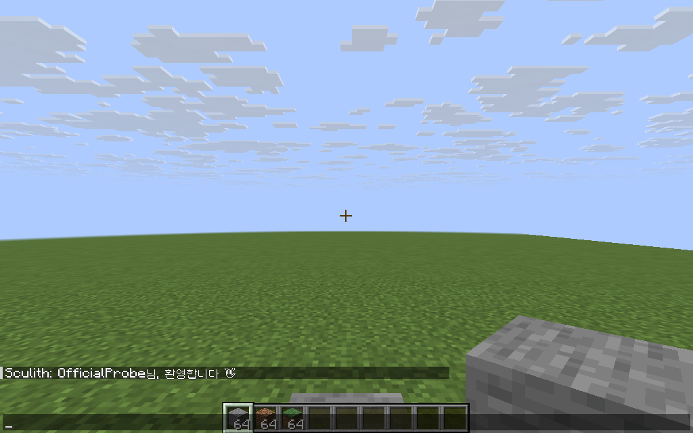

# Rust game plugin API v2 verification — 2026-11-16 KST

Tested source: [b64f81cc](https://github.com/SKYRPG8957/Sculith/tree/b64f81ccfb551918b6b225b5e209976183a8f16c).
[Machine-readable results and retained executable/screenshot hashes](plugin-api-v2-result.json).
Native Windows release/plugin checks also pass in [run 43783043722](https://github.com/SKYRPG8957/Sculith/actions/runs/43783043722).
The exact build is available as [Preview 10](https://github.com/SKYRPG8957/Sculith/releases/tag/v0.1.0-preview.10).
A fresh public download passes source/hash verification; Windows PowerShell 5.1
installation, both launchers, preservation of existing directories and the
documented one-command installer pass in [run 43785490869](https://github.com/SKYRPG8957/Sculith/actions/runs/43785490869).

The Rust gameplay example received the initialized player's edition-independent
join event and sent a private Korean/emoji welcome through the world owner.
An **unmodified official Java 26.3 game** displayed the result on Linux:



The official game JAR is unchanged, SHA-1 `e877b6a07acd633fb3bb475002175cec036e7b87`.
This reuses the stock client/runtime/software Vulkan environment recorded in
[the initial game verification](2026-11-16-java26.3.md). No client mod, proxy,
online account authentication or official Windows Bedrock rendering is claimed.

## Independent executable checks

```sh
cargo build --workspace --locked
python3 scripts/plugin_game_smoke.py --client target/gophertunnel-probe
```

The wrapper starts the real server and real Rust gameplay plugin from a path
with spaces. A separate Python byte-level Java client verifies its exact private
welcome and Java modified UTF-8. The independent Go/Pion/gophertunnel Bedrock
client decodes the native System text packet and the same Korean/emoji contents.
Both clients share one owner; Java receives no private welcome intended for Bedrock.
An accepted Java break triggers a Rust `BlocksChanged` callback with the committed
revision, and the plugin receives `Stopping` on graceful process shutdown.

```text
PASS: real Rust API-v2 plugin, private Unicode welcome in both editions, no cross-player leak, committed block hook and graceful stopping
```

A previously compiled **v1 Rust welcome executable** also passes the new host's
network/plugin smoke, including native sessions and graceful lifecycle handling.
It is not recompiled against v2 for this check. SDK tests cover automatic v2
selection, v1 fallback for legacy hooks and explicit rejection of game hooks on
an old host. Two independent worker processes use a synchronization barrier to
verify concurrent callbacks while preserving configured action order.

Owner tests cover pending/closed recipient rejection, the per-player monotonic
message budget, no world revision change and no message feedback into game hooks.

## Failure reproduced before correction

The first actual-game attempt failed decoding `minecraft:system_chat` with
`UTFDataFormatException` at the emoji. Passing `nbtx::Value::String` had used its
raw BString representation, which preserves four-byte UTF-8. Java NBT requires
modified UTF-8 with surrogate pairs. The adapter now serializes a Rust String
through the library's Java text encoder before removing the network root name.

The independent reader was strengthened to reject four-byte sequences in Java
NBT. It **fails against the old binary** and passes the corrected one; a codec
test checks the exact six-byte surrogate encoding of the waving-hand character.
The unmodified game then displayed the welcome above and remained connected.

## Scope

Plugins remain trusted executable JSON-lines processes, not a WASI sandbox.
Game hooks are post-commit notifications and cannot cancel an action. Messages
are validated and limited by the owner; private contents go only to the selected
initialized session. General world edits, commands, shared custom sound/model/UI
APIs and automatic resource-pack delivery remain further work.
