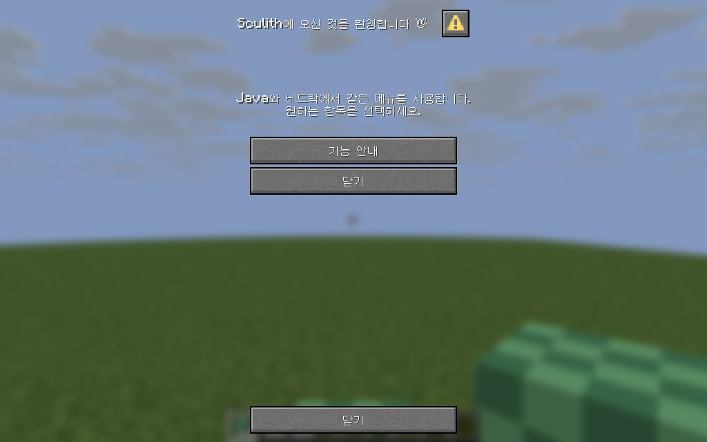
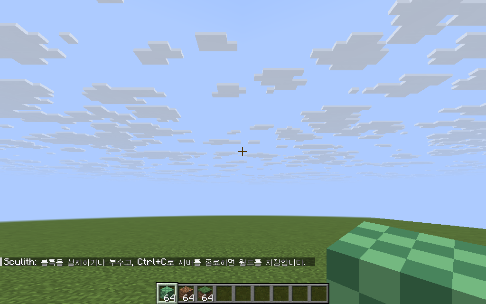

# Shared forms

Rust plugins can open shared choice forms (API v3) or typed input forms (API v11)
and receive validated private responses. Bedrock uses a native menu form; unmodified
Java 26.3 uses a vanilla multi-action dialog. This is a functional UI fallback,
not automatic conversion of arbitrary Bedrock JSON UI, images, HUD or scripting.

```sh
cargo build --workspace --locked
cargo run --locked -- run --config examples/configs/forms.toml
```

The choice example enables the gameplay welcome and shared texture pack. For text,
checkboxes, selection lists and integer sliders, run:

```sh
cargo run --locked -- run --config examples/configs/inputs.toml
```

The input example loads the same forms executable with `args = ["--inputs"]` and
shares the configured resource pack. Append `.exe` to plugin paths on Windows.

## Plugin contract

Subscribe to `Hook::PlayerJoined` and `Hook::FormSubmitted`. After initialization:

```rust
use sculith_plugin_api::{Action, SimpleForm};

let action = Action::ShowForm {
    player_id: player.id,
    request_id: 7,
    form: SimpleForm {
        title: "Welcome 👋".into(),
        body: "Choose an option.\nThe same menu works in both editions.".into(),
        buttons: vec!["Help".into(), "Close".into()],
    },
};
```

The example is a callback fragment; `player` comes from `Event::PlayerJoined`.
`request_id` is your own request key, not a native packet identifier. The result is
`Event::FormSubmitted { player_id, request_id, selection }`: `Some(index)` for a
button, `None` for cancellation. The Java exit button/Escape maps to cancellation;
Bedrock closed/busy/null responses also map to cancellation. A button that you
label "Close" remains a normal indexed choice. Results go only to the plugin
that opened the form, even when another plugin subscribes to the same hook.

Title and each button: nonblank, at most 128 UTF-8 bytes, no control characters.
Body: at most 2,048 UTF-8 bytes; newline is supported. There must be 1–8 buttons.
Labels are plain text, never client commands, action identifiers or arbitrary JSON.
The host validates the entire action batch before applying it.

The world owner checks a live initialized lease, one pending form per player and
a one-per-second form budget. It allocates nonwrapping internal IDs and checks
session, pending ID, choice bounds, monotonic time and the 60-second reply deadline.
Wrong IDs/choices retain the valid pending request. A valid selection/cancellation
consumes it once; replay cannot notify the plugin twice. Expired replies clear it
without calling the plugin. Disconnect cleanup removes pending state.

Opening a form never changes a block revision and never reenters game hooks as a
new request. Accepted replies are semantic events, separate from the protocol
observer stream. The existing bounded mailbox/game-event/worker policies apply.
Closed sessions, pending forms and rate limits are ordinary action rejections,
logged without disabling an otherwise valid plugin.

## Input controls (API v11)

Subscribe to `Hook::CustomFormSubmitted`, then send
`Action::ShowCustomForm { player_id, request_id, form: CustomForm { title, fields } }`.
The callback is `Event::CustomFormSubmitted { player_id, request_id, values }`.
`None` means cancelled; `Some(values)` contains one value per field in input order.
Results go only to the plugin that opened the form.

| Field | Definition | Result |
| --- | --- | --- |
| `FormField::Text` | `label`, `default`, `max_length` | `FormValue::Text(String)` |
| `FormField::Toggle` | `label`, `default: bool` | `FormValue::Toggle(bool)` |
| `FormField::Dropdown` | `label`, `options`, `default: u32` | `FormValue::Number(index)` |
| `FormField::Slider` | `label`, `min`, `max`, `step`, `default` | `FormValue::Number(value)` |

A form has 1–8 fields. Title, labels and options require 1–128 UTF-8 bytes without
control characters. Text accepts an empty value and at most `max_length` UTF-16
units (1–256); a supplementary character uses two units. The Java widget enforces
this limit while editing; Bedrock responses are checked by the owner. Control
characters are rejected. Dropdowns have 1–8 options and zero-based indexes.

Sliders use integers in `[-32768,32767]`, `min < max`, and a positive `step` at most
65535. The range and default must lie on that step grid; replies outside it are
rejected. Fractional sliders and password/multiline inputs are not implemented.

Choice and input forms share one pending slot and the existing rate, session,
60-second deadline and replay checks. Wrong IDs, counts, types, text lengths or
slider steps keep the valid request pending. Cancellation uses the owner's stored
form kind. Form callbacks never grant gameplay permissions or change world
revisions. Inputs add no player data persistence.

Bedrock receives a `custom_form`; Java receives a vanilla dialog with text,
boolean, single-option and number-range controls. Only a generated custom action
can submit its values: no plugin-supplied action IDs or executable commands are
sent. Java replies accept a bounded flat compound of strings, boolean bytes and
integer-valued finite floats, with strict modified UTF-8 and unique consecutive
input indexes. Native replies accept a bounded typed
array. Payloads are at most 16 KiB; nesting and unknown value types are rejected.
UI layout and native styling differ; this is shared form behavior, not arbitrary
Bedrock JSON UI or HUD conversion.

```sh
python3 tests/interop/custom_forms_smoke.py --client target/gophertunnel-probe
```

The unmodified Java game also displays and submits all four controls through
actual keyboard/mouse input. [Evidence and limits](../development/verification/custom-forms.md).

The probe runs real Rust controller/observer processes and independent Java/native
clients. It checks all four definitions, Unicode input, cancellation, malformed
replies, step/length/count/type validation, replay and recipient isolation.

## Client implementation and verification

The unmodified Java game displayed Korean/emoji title, body and buttons:
[Exact source, actual mouse/Escape outcomes and hashes](../development/verification/2026-11-16-shared-forms.md).



An actual mouse click reached the owning Rust plugin and displayed its private
help response while the server-delivered checkerboard remained active:



The independent executable probe checks the same text in both editions:

```sh
python3 tests/interop/forms_smoke.py --client target/gophertunnel-probe
```

An independent Python NBT reader checks the Java direct dialog holder, nested
modified UTF-8 and static custom actions. The separate Go/Pion Bedrock client
decodes native form JSON and returns numeric choices/cancellation. It attempts to
answer another session's form and sends a malformed choice first. The Java form
stays pending, receives no foreign private result and can still be answered.
The owning Rust worker receives exactly four callbacks across choices and
cancellations, while a second subscribed observer worker receives none. Replays
do not add callbacks. Graceful stopping is checked.

Domain/owner tests cover pending/dead leases, wrong IDs, invalid indices, replay,
clock regression, expiry, rate limits, ID exhaustion, no world revision change and
separation of presentation from semantic result events. SDK tests cover highest
common version selection and rejection of UI hooks on a v2-only host. Real retained
v1 and v2 Rust binaries continue to pass the corresponding executable checks.

Primary wire facts come from the pinned official Java 26.3 codecs: play ShowDialog
143 uses an inline holder followed by network NBT; CustomClickAction 68 includes a
length-prefixed optional NBT payload. This adapter emits static custom actions with
no payload and accepts their one-byte TAG_End payload. Java text is encoded as
modified UTF-8, including nested supplementary characters. Native packets are
ModalFormRequest/Response 100/101 in the pinned V2225 dependency and independent Go
codec. No decompiled implementation or proprietary game assets are distributed.

Choice and the bounded input controls above are supported. There is no arbitrary
JSON UI, replacement/cancel API, automatic on-screen timeout close or expiry
callback yet.
An unanswered form occupies the one pending slot until a response or disconnect;
an expired answer is not applied. Callback success does not grant permissions for
future game actions. Official Windows Bedrock rendering remains unverified;
native results here are independent protocol-client results. Plugins remain
trusted executables, not a sandbox.
