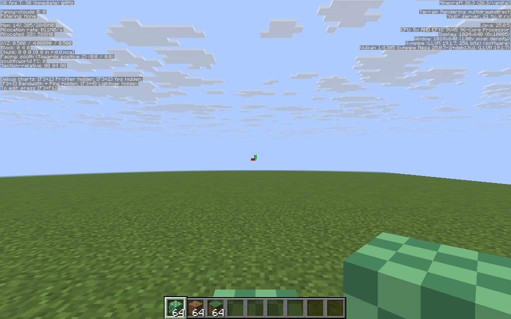

# Shared content pack delivery

Current source can freeze one authored Bedrock resource-pack directory, convert
its explicitly mapped PNG overrides and single-clip Vorbis sound events and deliver the resulting archives at login.
The two adapters still use one authoritative world. This adds content delivery;
it does not implement custom block/item registration, model/arbitrary-UI conversion
or a separate Java simulation.

```sh
cargo build --workspace --locked
cargo run --locked -- run --config examples/configs/packs.toml
```

The source example includes the Rust gameplay plugin (append `.exe` to its path
when building on Windows). Java **26.3** connects to `127.0.0.1:25565`; Bedrock
uses `127.0.0.1:19132`. Accept the game's resource-pack prompt when shown. Stone
uses the original green checkerboard from `examples/pack/bedrock` in both packs.
The default source configuration still has no content pack. Public Windows
Preview 14 bundles the example assets and enables them only in newly created
settings. Existing settings are preserved.

## Configure and inspect

Paths resolve relative to the server configuration file:

```toml
[content]
source = "packs/my-bedrock-pack"
mapping = "packs/textures.json"
# Optional loopback listener for the Java ZIP; port 0 selects a free port.
bind = "127.0.0.1:0"
```

The source must be a format-2 resources-only pack. A content mapping (textures and/or sounds) is required,
even for a native-only preview. Pack dependencies, subpack selection, scripts and
behavior modules are rejected. Resource names currently require portable ASCII
paths. Mapped PNGs keep the existing dimension/decoder limits and Java targets
must already exist in the vanilla resource set. The conversion report explicitly
lists unsupported assets; the native archive includes the original resource files.

To inspect both archives without starting a server:

```sh
target/debug/sculith pack bundle \
  --input examples/pack/bedrock --mapping examples/pack/textures.json \
  --output /tmp/sculith-edition-packs
```

Choose a new output directory. It contains `bedrock.mcpack`, `java.zip` and
`bundle.json` with identifiers, version, hashes and conversion limitations.
No Minecraft client JAR or proprietary game assets are needed or distributed.

## Delivery and bounds

- Both archives come from one frozen source/mapping snapshot at startup. Sessions
  share immutable bytes; requests do not reread files or regenerate packs.
- Source: at most 512 files, 1,024 directory entries, 16 nested directory levels,
  16 MiB per file and 32 MiB total. Symlinks and special files are rejected.
  Each final ZIP, including headers, is at most 32 MiB. Stored ZIP members have
  fixed dates and sorted names; identical inputs produce identical artifacts.
- Native cache UUIDs derive from the original namespace and complete content
  digest. Generated module UUIDs match the generated pack. The source manifest is
  preserved. A changed asset changes the generated cache identity even if an
  operator forgot to increment the authored version. Java uses a content-derived
  pack UUID and the protocol-required ZIP SHA-1.
- Java: exact immutable `/packs/<sha1>.zip` route; GET/HEAD only, loopback peers,
  eight HTTP connections, 8 KiB HTTP buffering and a ten-second connection bound.
  Bodies, alternate/query paths and traversal routes are rejected. Resource-pack
  status must identify this offer and follow acceptance/loading order before world
  reservation. Configuration keepalives continue while consent/reload is pending;
  an in-flight liveness reply can follow the successful loading response.
- Bedrock: required info → optional download → required stack → stack completion.
  SHA-256, size and 32 KiB chunks are supplied; request IDs and indices are checked,
  each chunk may be requested twice and negotiation is capped at 4,096 packets.
  A cached client can skip download. Player reservation follows pack negotiation.
- The existing configured login deadline still applies (maximum 60 seconds).
  A declined, invalid or failed required pack does not silently become optional.
  The service is local development infrastructure, without public hosting or hot
  reload. Restart to load a changed source pack. These limits are not a process-wide
  memory or gameplay throughput claim.

## Verification

```sh
python3 tests/interop/pack_delivery_smoke.py --client target/gophertunnel-probe
python3 tests/interop/pack_delivery_smoke.py --client target/gophertunnel-probe --wait-for-keepalive
```

Python's independent ZIP reader checks CRCs, hashes, fixed dates and exact texture
bytes. A separate Java wire client downloads the HTTP offer before acknowledging
it; negative cases reject decline, wrong UUID, premature success and reload failure.
The independent Go/Pion client downloads more than two native chunks, decodes the
pack, enters the world, saves the exact received archive and reconnects through its
own cache. A delayed consent test waits for four ten-second liveness requests and
returns the last reply after loading completion. Rust socket tests additionally
reject unknown IDs, early completion, invalid chunk indices and excessive retries.

An unmodified Linux Java 26.3 game has downloaded the server pack and rendered the
checkerboard on held Stone. This is separate from independent Bedrock wire tests;
official Windows Bedrock rendering remains unverified.
[Exact source, fresh-download evidence and hashes](../development/verification/2026-11-16-shared-pack.md).



Wire references: the pinned official Java 26.3 packet codecs (official server
report-tool SHA-1 `33680f5f2ac32864d6d7cf5e56a705fdb3e05f4c`) and
[gophertunnel e2251a60](https://github.com/sandertv/gophertunnel/tree/e2251a60f71d)
for versioned Bedrock download/stack/cache behavior. Archive layout follows the
[PKWARE ZIP specification](https://pkware.cachefly.net/webdocs/casestudies/APPNOTE.TXT).
No decompiled implementation is shipped.
