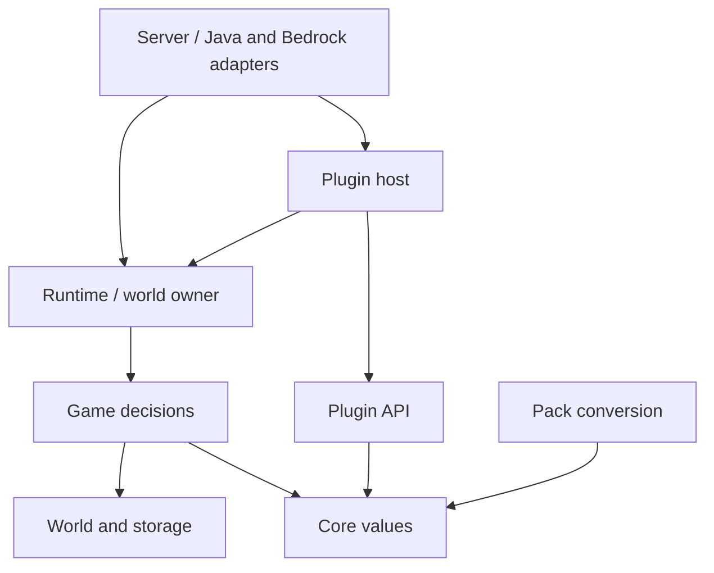

# Architecture

Both protocol adapters submit inputs to one world owner. The owner validates and
commits game changes, then publishes events for connected players and plugins.
Java and Bedrock never run separate simulations.

## Crates

| Crate | Responsibility |
| --- | --- |
| `sculith-core` | Shared values, forms, command definitions and receipt metadata |
| `sculith-world` | Blocks, chunks, regions, revisions, snapshots and storage |
| `sculith-game` | Player state, movement/build validation, inventory and commands |
| `sculith-runtime` | World-owner mailbox, leases, committed events and peer interest |
| `sculith-plugin-api` | Versioned Rust SDK and JSON-lines messages |
| `sculith-plugin-host` | Plugin processes, lifecycle, deadlines and action dispatch |
| `sculith-packs` | Bedrock resource validation and supported Java conversion |
| `sculith-server` | Executable configuration, protocol adapters and service lifecycle |

Game decisions have no Bedrock, RakNet, NetherNet or Tokio dependency.
The runtime has no dependency on the server executable or plugin SDK.
The plugin host consumes runtime events; it does not own a second game state.
Example plugins depend on `sculith-plugin-api`.
`sculith-server` retains re-exports of its original engine modules for embedded callers.

Run `python3 scripts/check_architecture.py` to verify these boundaries. CI runs the
same check on Linux and Windows.

## Ownership and events

`Region` is movable but neither `Sync` nor `Clone`. A commit requires mutable
owner access and the current revision. Network sessions submit requests through a
32-entry mailbox. They read immutable snapshots; changed sections use copy-on-write.

Game, session and peer event streams are bounded at 128 entries. Block changes
carry chunk revisions. Private forms, commands and presentation effects keep their
recipient and plugin ownership. Packet hooks expose metadata, never login payloads.

There is currently one region owner. The 20 Hz plugin clock is not a physics tick.
Parallel region scheduling, migration, merging and splitting remain future work.

## Persistence and plugins

Region snapshots load at startup and save after sessions close on orderly
shutdown. Blocking workers encode/store snapshots with atomic replacement.
Periodic saving, crash recovery and persistent player inventories are pending.

The current plugin backend runs trusted executables. Timeouts and bounded API
messages are enforced, but this is not an OS sandbox. WASI Component execution is
still to be evaluated. See the [plugin guide](../guides/plugins.md).

## Content

Bedrock packs are the source. The pack crate converts selected static textures,
single-clip Vorbis sounds and cuboid models. Stock Java uses resource packs,
dialogs and display entities. General geometry/animation, JSON UI, Molang and
Script API compatibility remain unfinished.

Versioned sources and licenses are in [third-party notices](../../THIRD_PARTY_NOTICES.md).
The full implementation targets remain in the [engineering directive](../development/engineering-directive.md).
