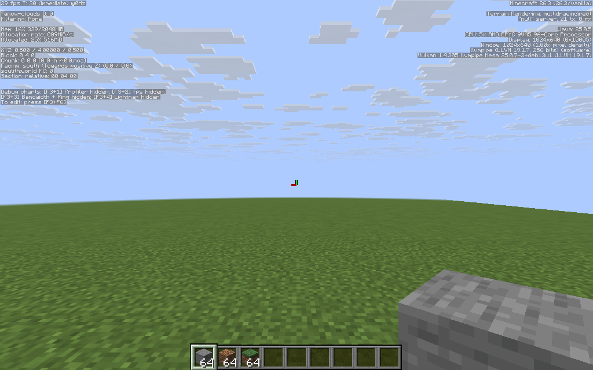
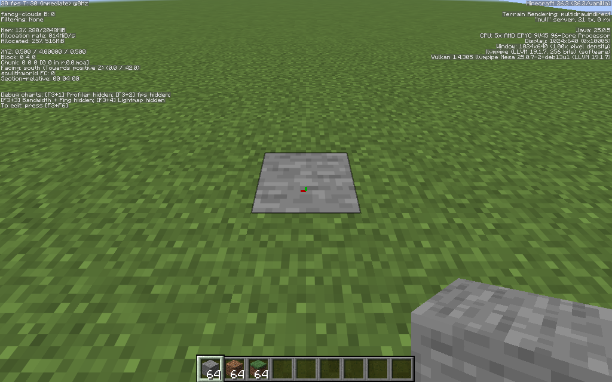
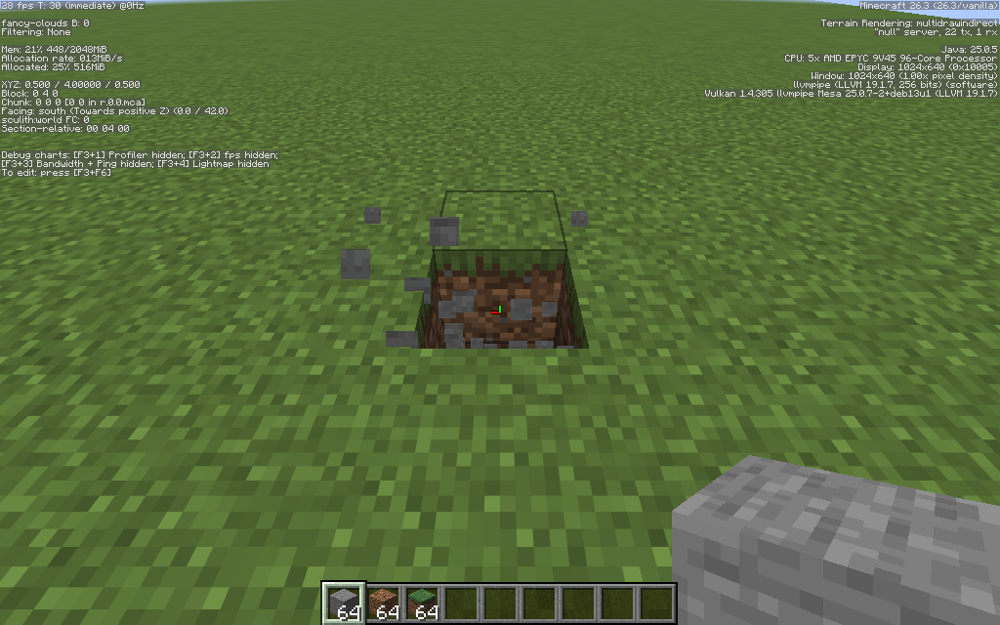
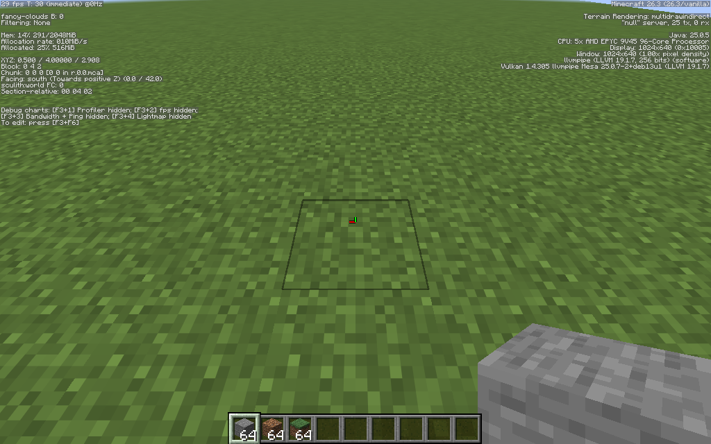

# Actual Java 26.3 client verification — 2026-11-16 KST

An **unmodified official Java 26.3 game client** entered Sculith's local world,
rendered the flat terrain, accepted keyboard movement, and placed/broke blocks
through actual mouse input. This is a Linux offline-identity test. It does not
establish official Windows Bedrock entry or online account authentication.

## Artifacts and environment

- Official client JAR SHA-1: `e877b6a07acd633fb3bb475002175cec036e7b87`,
  obtained through the [official version manifest](https://piston-meta.mojang.com/mc/game/version_manifest_v2.json).
  The client, its platform libraries, asset index 34 and 5,149 unique asset objects
  were downloaded and checked against their official hashes. No client code was
  modified and no mods, proxy or separate Minecraft server were used.
- Java runtime: Eclipse Temurin 25.0.5+8. Linux x86_64; Xvfb 1024×640; Mesa
  25.0.7 lavapipe/LLVM software Vulkan 1.4.305. OpenGL initialization failed on
  this virtual display; the stock client's Vulkan fallback worked after providing
  the standard Mesa software driver. This is functional evidence, not a GPU/TPS benchmark.
- Sculith: the shared-world source with the two wire corrections below, local
  TCP `25565` and Bedrock NetherNet/UDP `19132`, one owner and one region snapshot.
  The test profile `OfficialProbe` is a local offline name. Microsoft services
  were unavailable to this JVM; their authentication was not claimed or bypassed.

## Observed results

1. The real game completed configuration and both initialization acknowledgements.
   The server logged `Java client acknowledged the shared flat-world spawn`.
   F3 displays **Minecraft 26.3 / Vanilla**, the `sculith:world` dimension and
   coordinates `(0.500, 4.000, 0.500)`. The session remained connected for several minutes.
2. The independent gophertunnel/Go/Pion Bedrock client joined the **same running
   server**. Its Dragonfly decoder verified all 2,457,600 blocks in 25 spawn chunks.
   It broke grass at `(0,3,2)`; the hole appeared in the actual Java game.
3. Java mouse input placed Stone, broke it, then placed it again at `(0,3,2)`.
   The independent Bedrock client received the exact committed sequence below.
4. A short W-key press moved the actual game from Z `0.500` to approximately
   `3.190` after flight deceleration. The position stayed changed and no movement
   correction was logged. This is limited creative movement, not full physics.
5. The game's **Disconnect** button closed the session. A status request then
   reported **zero online players**. After orderly server shutdown/restart, the
   real game re-entered, and a separate independent Java reader verified every
   spawn voxel, including the retained Stone at `(0,3,2)`.

```text
PASS: independent Dragonfly decoding of 25 chunks, all 2457600 blocks, plains biomes and startup definitions
PASS: independent gophertunnel NetherNet world spawn 2
CROSSPLAY: committed [0 3 2] minecraft:air
CROSSPLAY: committed [0 3 2] minecraft:stone
CROSSPLAY: committed [0 3 2] minecraft:air
CROSSPLAY: committed [0 3 2] minecraft:stone
PASS: Bedrock break and Java place/break/place shared in one world
```

Screenshots are direct, unedited captures of that game:

| Flat world / Vanilla | Java mouse placement |
| --- | --- |
|  |  |

| Java mouse breaking | Keyboard movement |
| --- | --- |
|  |  |

## Failures found and corrected

The first actual attempt against Preview 8's Java behavior failed decoding the
play-state `minecraft:login` packet. Java 26.3 uses **VarInt GameType** and
**OPTIONAL_VAR_INT previous GameType** (zero = absent), rather than the older
signed-byte `-1` sentinel. That byte consumed the following field in the real decoder.

The second attempt decoded the world but Sculith rejected the teleport confirmation
with trailing fields. Protocol 777's confirmation carries **ID, X/Y/Z and yaw/pitch**.
Sculith now validates all fields against its own correction, including finite values;
the confirmation does not become an independent movement request.

These facts were checked against the checksum-pinned official client's packet
codec/field definitions using development-only MIT CFR 0.152
(SHA-256 `f686e8f3ded377d7bc87d216a90e9e9512df4156e75b06c655a16648ae8765b2`).
Only independently implemented wire handling is checked in. No decompiled game
implementation, client JAR or game asset files are distributed with Sculith.
The older versioned MCProtocolLib reference did not capture these two layouts.

The independent Python client now checks the corrected fields and rejects wrong
or non-finite confirmation positions. The real-socket Java/RakNet/NetherNet owner
regression also sends the full current acknowledgement.

## Reproduce the shared edit observation

Build the pinned client in `tests/interop/gophertunnel` as documented there, then
connect it to an otherwise flat running local preview:

```sh
target/gophertunnel-probe http://127.0.0.1:19132 --crossplay
```

It first performs its normal full chunk verification, breaks `(0,3,2)`, then
allows 120 seconds for the graphical Java player to place/break/place Stone at
that coordinate. It requires the exact committed sequence; it does not send
the Java player's edits itself. The optional mode is for this manual graphical
companion test; the normal bounded CI probe is unchanged.

Official Bedrock still uses an independent headless client in this report.
Other-player rendering, general inventory, survival/gravity, online Java login
and shared custom models/sounds/UI remain unfinished. Gameplay support lists and
the package's broad `official_client_verified: false` stay conservative; this
specific Linux Java local scenario is the official-game evidence established here.
