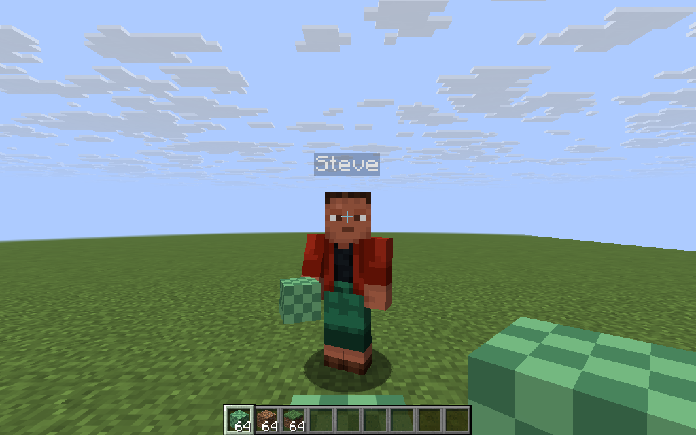
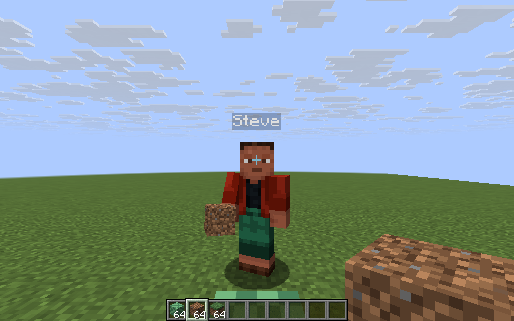
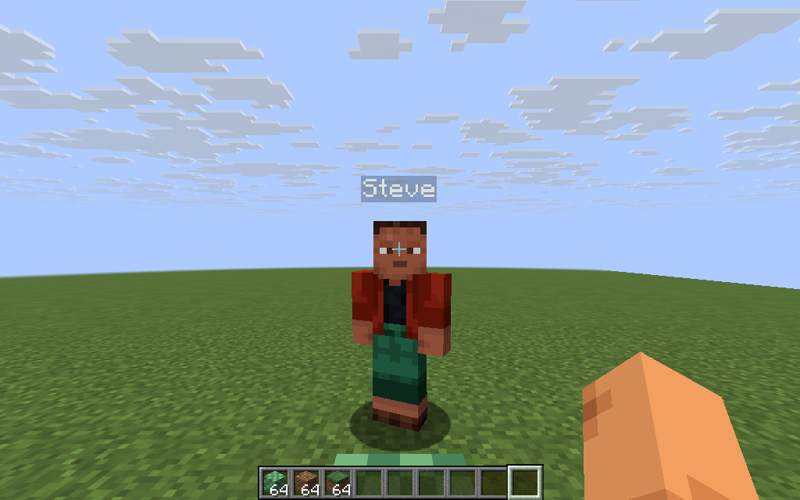

# Shared held items — 2026-11-16

Runtime source: `5eba35cb0f9ca3843b2bfb6d71e7796433b3ca1a`.
This projects the fixed creative starter hotbar; it does not add general inventory.

## Actual stock Java game

Unmodified official Java **26.3**, protocol **777**, Linux/Xvfb, stock Vulkan
renderer with Mesa lavapipe. Client JAR SHA-1
`e877b6a07acd633fb3bb475002175cec036e7b87`; no client mods, injected classes,
rewritten assets or account credentials. Offline `OfficialProbe`, loopback only.
The separately running native Go/Pion companion is not the official Bedrock game.

Both clients accepted the same authored source pack. Actual Java rendered its own
and the native peer's Stone with the same original checkerboard texture. Real key
`2` selected Dirt; the native peer independently decoded item ID 3/count 64/slot 1.
The native peer then selected Dirt and Java rendered its changed held item. Real
key `9` cleared the Java hand and the native peer independently decoded the empty
selection. A native empty-slot selection cleared its Java-rendered hand as well.
Both hands remained empty, and native departure removed the avatar normally.

Raw, unedited screenshots:

[All six raw capture hashes, executable hashes and native output](shared-equipment-result.json).
The Linux server SHA-256 is
`d734142ad3bb94c273be0c5271f4369e9927af44f91cc5a30b476d7672c8370c`.
The companion requested native slot changes at 7 and 14 seconds and remained for
30 seconds. Only the actual Java game supplies rendering evidence. Official
Windows Bedrock entry/rendering and online authentication remain unverified.

## Independent checks

Linux Clippy, **136 project tests** and the ownership doctest pass. Independent
Java/Go checks cover initial hands, both selection directions, current late-join
equipment, empty hands and disconnect cleanup. A valid but false native item/count
claim (Stone/count 1 for the Grass slot) is corrected to the owner-selected
Grass/count 64, including the local native correction and remote Java item.

Owner tests require initialized leases, reject invalid slots, suppress repeated
selections and retain the latest selection in fresh snapshots. Equipment updates
stay off private/game-hook streams and do not change region revisions. Projection
tests retain hidden-peer equipment for re-entry and reject updates after leave.
Block/input fixtures still observe local corrections, and private-model tests keep
their strict actor-ID separation while independently reading ordinary peer frames.
Existing Java, peer visibility, gameplay plugin, forms, sounds, models, packs/cache,
consent keepalive, session and persistence checks pass.

Three timing samples in the JSON record measure the **whole debug integration
harness**, including process startup, Python/Go voxel decoding and local transports,
with the GUI also running. They are not server TPS, network latency, server memory
or scalability measurements.

## Wire contract and scope

The owner emits a public equipment update only after a changed hotbar selection.
Java packet 104 uses main-hand ordinal zero, one terminating equipment entry and
the normal optional item-stack codec. Native AddPlayer and MobEquipment share the
same selected stack as the local authoritative inventory correction. Empty air
has an empty user-data payload. References: official Java 26.3 packet/registry
report and client manifest, MIT gophertunnel `e2251a60f71d`, Apache-2.0 bedrock-rs
`5221fcae`. No official game code or assets are distributed.

Counts stay 64 in the existing creative preview. General inventory transactions,
item pickup/drops, armour/offhand, durability, account skins/capes, animation and
combat are pending. The Rust plugin API remains version 5.

Native Windows [run 43819324302](https://github.com/SKYRPG8957/Sculith/actions/runs/43819324302) passes at the exact source above, including
independent equipment/forged-claim checks and the existing peer, game/plugin,
form/sound/model, packs/cache, persistence, packaging and launcher checks.
Inspected archive: **6,594,214 bytes**, SHA-256
`bae1d47488b3ea20cdd886ffd90ac08cfea81c16c0e70b87332721367b446f6e`.
It contains 24 members and five EXEs with system DLLs only. The nine source pack
files match (JSON with checkout CRLF/LF normalization; PNG/OGG byte-identical),
with matching lockfile/license and exact-source metadata. The README describes
held-item support correctly. No keys, worlds, game JARs or test clients are included.
Public download and installation validation are pending.
