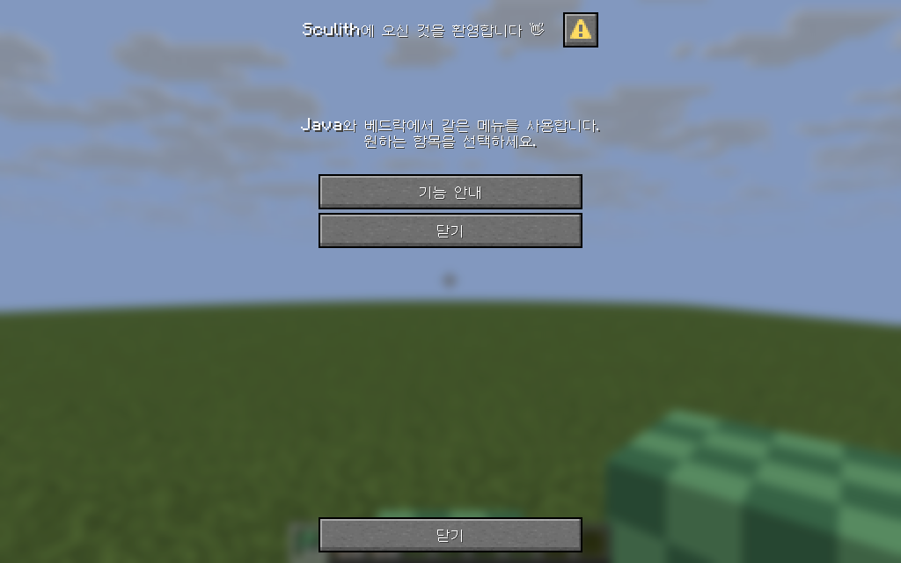
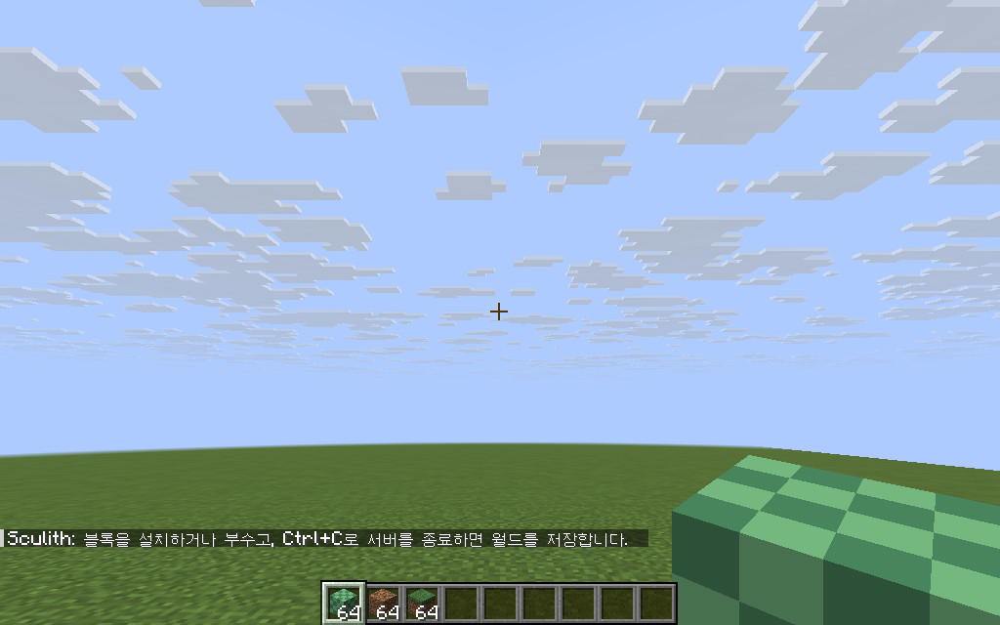
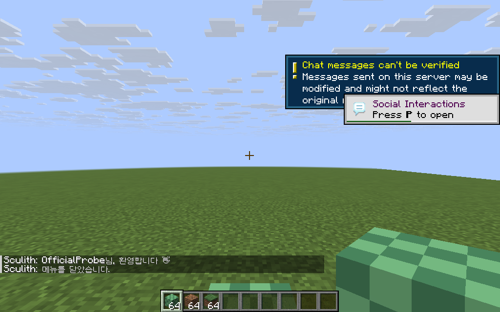

# Shared forms verification — 2026-11-16 UTC

Tested source: [2a558216](https://github.com/SKYRPG8957/Sculith/tree/2a5582163bb200bd8991aeed5991625e9808c210).
[Results, exact package and unedited screenshot hashes](shared-form-result.json).
Native Windows [run 43795929884](https://github.com/SKYRPG8957/Sculith/actions/runs/43795929884)
passes workspace/vendor/Clippy/doctest, built-executable network/world/plugin,
independent Java/aiortc/Go/Dragonfly, shared forms and pack/cache checks. The exact
ZIP, sixteen members, metadata, dependency licenses and system-DLL-only imports
of all three EXEs were inspected.

An unmodified official Java **26.3** game on Linux displayed the shared form:



The official game JAR remains SHA-1
`e877b6a07acd633fb3bb475002175cec036e7b87`, with the same verified assets,
Temurin/software-Vulkan environment from [the initial game test](2026-11-16-java26.3.md).
There is no mod, proxy or separate Minecraft server. This uses a local offline
identity; online account authentication is not tested.

A real mouse click selected Help and produced the owning Rust plugin's private
response. The server-delivered checkerboard pack remained active:



A separate re-entry against the committed runtime opened a new menu. A real
Escape-key press generated the cancel custom action; the owner validated and
consumed it and the Rust plugin displayed the cancellation result:



One earlier menu was deliberately left idle beyond the reply deadline. Its later
click was rejected with `form reply expired`; a fresh menu could be answered.
The final Help attempt waited 25 seconds for stock client toasts to clear, then
completed within the 60-second reply deadline. Images are direct captures.
Owned game/server/display processes were stopped after recording the results.

## Independent checks

Linux passes 120 project tests, the ownership doctest and Clippy. Real previously
compiled API-v1 and API-v2 Rust executables pass the new host; their hashes are
retained in the result JSON. SDK tests check highest common-version negotiation,
v2 fallback for existing game hooks and rejection of UI hooks on a v2 host.

```sh
python3 scripts/forms_smoke.py --client target/gophertunnel-probe
python3 scripts/plugin_game_smoke.py --client target/gophertunnel-probe
```

The form wrapper starts the actual Rust plugin plus a second independently
subscribed observer worker. A byte-level Python Java client reads nested NBT and
the six-byte surrogate form of supplementary Unicode. A separate pinned Go/Pion
client reads native form JSON and returns choices and cancellation. It sends a
foreign session ID and a malformed response first; the other session's valid
pending form remains usable. Both editions receive only their own presentation
and private result. The owning worker receives exactly four semantic callbacks;
the observer receives none. Replay does not add callbacks and Stopping is checked.

Owner tests also check pending/dead leases, clocks, expiry, budgets, internal ID
exhaustion, no world revision mutation and no result in the protocol observer
stream. The controller does not wait on plugins.

The form adapter is a plain choice-menu fallback. Arbitrary JSON UI, inputs,
images, HUD, automatic timeout close and general game APIs remain further work.
Official Windows Bedrock game rendering is still unverified; its results here
come from independent protocol clients. Plugins remain trusted executables.
[API, bounds and primary wire-fact provenance](../forms.md).
