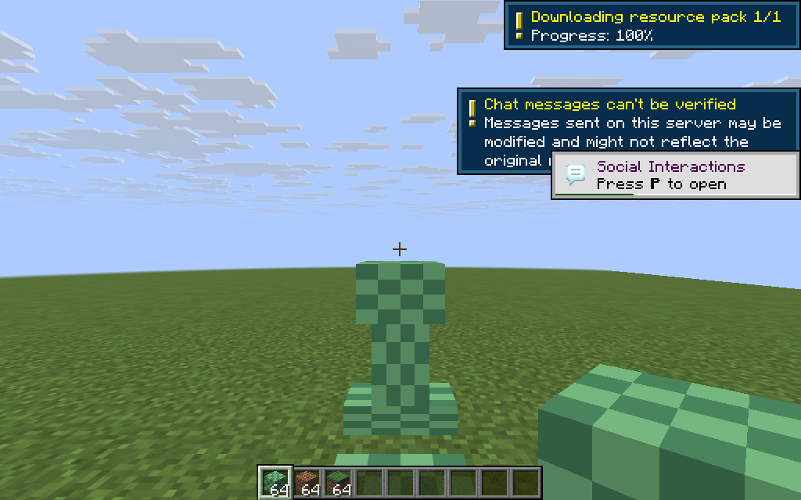
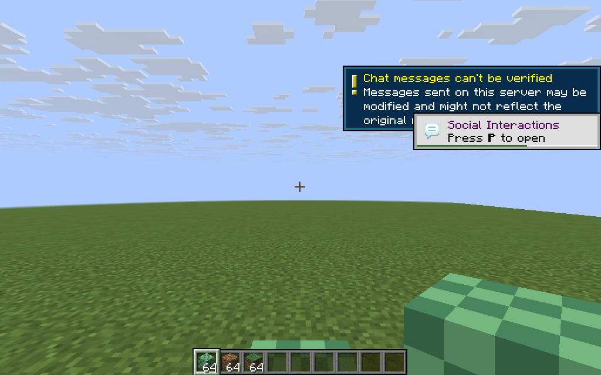
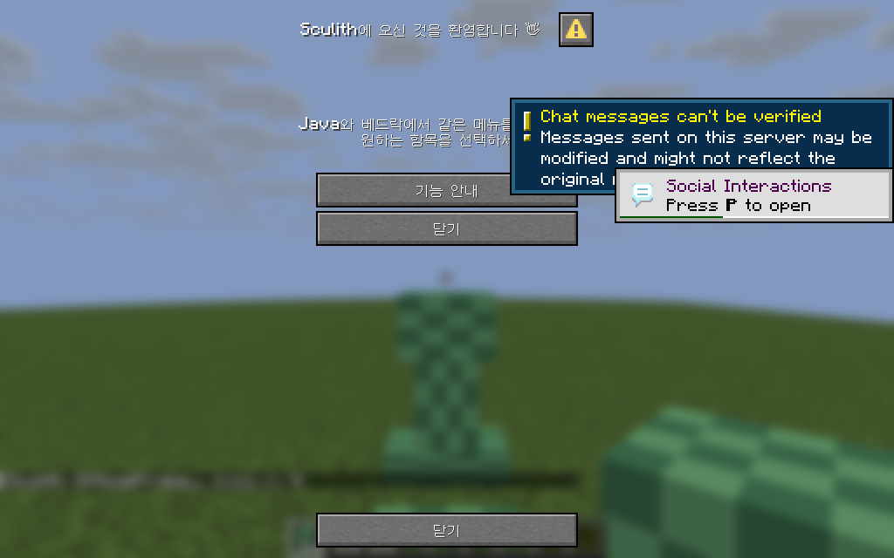
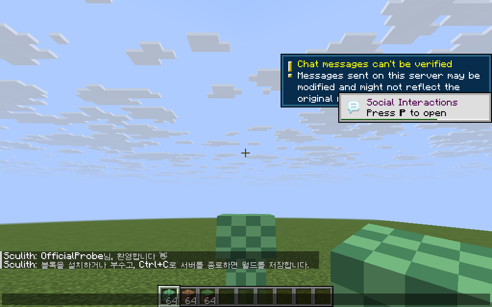

# Shared static model verification — 2026-11-16 UTC

Scope: local offline Java 26.3/protocol 777 and independent native protocol 2225,
one region owner. The user is away; no official Bedrock retest is assumed.

Initial actual-game testing rendered the original three-cuboid statue using a
stock Item Display Entity. The first texture path was under `entity/`; Java 26.3
logged a missing sprite and displayed the missing-texture checkerboard. Inspection
of the checksum-pinned official client's `items.json` atlas confirms the `item/`
directory source. Moving the generated model texture there fixes the actual game:
the statue renders with the original green checkerboard and no missing-sprite log.
The game JAR SHA-1 remains `e877b6a07acd633fb3bb475002175cec036e7b87`.

The wire facts are checked against the pinned official report/client:
AddEntity 1; RemoveEntities 78; SetEntityData 101; item_display type 73; item_model
component 10; base metadata count eight; Display count fifteen; item metadata 23
with Optional ItemStack serializer 7; context byte 24. The new LP Vec3 velocity's
zero is a single byte, before rotation. Only facts and an independent Rust encoder
are shipped, without copied client implementation or Minecraft JAR/assets.

Independent Python/Go tests pass the required packs, exact original PNG/geometry,
native actor ID registration, show/replacement/hide and two-session privacy. The
native reader independently decodes current AddActor optional fields. Rust owner
tests preserve world revision and game hooks while rejecting invalid lease,
catalog, clock/rate and bounds requests. Conversion rejects unsupported rotation,
bone cycles, out-of-bounds UV and generated-file collisions.

Linux workspace tests, Clippy and ownership doctest pass. Retained actual v1/v2/v3/v4
Rust executables pass the new host, including old forms/sounds and pack/cache/consent
regressions. Exact source `1d46a8164cb27007daf45f89bb0afec5a015ada5` passes native Windows
[run 43807085201](https://github.com/SKYRPG8957/Sculith/actions/runs/43807085201), including
models/actor lifecycle/privacy, both transports, all plugin/form/sound/pack checks,
license packaging and extracted launchers. Linux CI 43807085178 and 43807082765 pass.
The ZIP is **6,526,986 bytes**, SHA-256
`d7809c89f6bba52d793d32ba9350cfdaba6fd4e7b37708e7fdd5bbe09961c2ff`.
Twenty-four members and all five EXEs were inspected; imports are Windows system
DLLs only. No private key, world, test log or Minecraft JAR/game assets are bundled.
Source/license text is unchanged apart from Windows checkout line endings. Official Windows Bedrock-game entry/rendering remains
unverified; independent native tests are not labelled official-game verification.

## Exact-source actual game

The [JSON record](shared-model-result.json) pins the client, exact runtime source,
Linux executable hashes, screenshot hashes, exercise timing and Windows artifact.
The earliest frame at 1.17 seconds shows the world before the model is visible;
it is retained with that accurate label. The 2.98-second frame shows the textured
statue after replacement, and the 5.18-second frame shows the connected world
after the four-second hide. All captures are unmodified.

A second normal run enables all four bundled examples, without the exercise
timer. The original model remains visible with the welcome/menu/sound examples.
A real mouse click returns `selection=Some(0)` to the owning Rust plugin; chat
history displays both its private help and the gameplay welcome. Actual stock
OpenAL output contains an 880-Hz tone, with 99.7579% of one-second Hann-windowed
spectral energy in 875–885 Hz. The file is stereo PCM16 at 48 kHz; no speaker
listening or official native rendering is claimed.

Owned game/server/display processes were stopped after each scenario. Temporary
client assets, game JAR, logs and device audio are not shipped.

A five-process small-pack debug CLI measurement includes process startup, file
I/O, validation and both archives. Source: nine files / 12,737 bytes; native/Java
ZIPs: 14,096 / 11,911 bytes. Median wall time is 7.790 ms, peak child RSS 16,356 KiB
(Linux `wait4`). This is not TPS, server memory or a large-pack performance claim.
Individual measurements and pack hashes are in the JSON record.

## Public publication

[Publication run 43808277834](https://github.com/SKYRPG8957/Sculith/actions/runs/43808277834)
publishes Preview 14 from this exact tested source. Fresh unauthenticated HTTPS
ZIP/checksum downloads pass source/tag/SHA-256 verification. Installer/download
defaults select Preview 14; native public installation is being checked.
