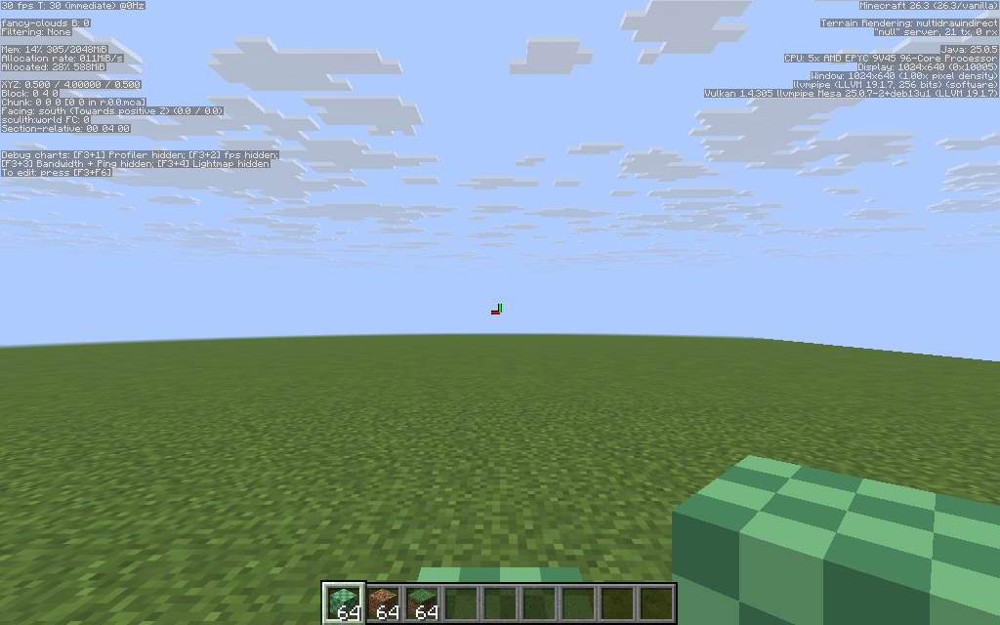

# Shared pack verification — 2026-11-16 UTC

An unmodified official Java **26.3 / Vanilla** client downloaded Sculith's
server-provided pack, entered the world and displayed the authored green
checkerboard on held Stone. It also received the existing Rust plugin welcome.
No mod, proxy or separate Minecraft server was used.



[Machine-readable results and screenshot/download hashes](shared-pack-result.json).
The exact actual-game source is [20115fec](https://github.com/SKYRPG8957/Sculith/tree/20115fec2795a438049333941ab43773c1ac2e03).
The release includes a retained-worker bound in
[9d7003be](https://github.com/SKYRPG8957/Sculith/tree/9d7003bee189722309ade9cb3a46041444ab4215)
and passes the independent pack probe. Native Windows verification passes in
[run 43789669645](https://github.com/SKYRPG8957/Sculith/actions/runs/43789669645),
which includes the Windows fixture-path correction in
[d207998f](https://github.com/SKYRPG8957/Sculith/tree/d207998fff7cc3144affc0a90b3541df9d1afb56).

The exact Windows artifact is public as
[Preview 11](https://github.com/SKYRPG8957/Sculith/releases/tag/v0.1.0-preview.11).
A fresh unauthenticated HTTPS download passes source/tag/hash verification.
Windows PowerShell 5.1 installation, both launchers, existing-directory preservation
and the documented one-command installation pass in
[run 43790911715](https://github.com/SKYRPG8957/Sculith/actions/runs/43790911715).

The stock client JAR SHA-1 remains
`e877b6a07acd633fb3bb475002175cec036e7b87`, in the Linux/Temurin/software-Vulkan
environment from [the original game test](2026-11-16-java26.3.md). Before the final
launch, the owned test profile's download cache was preserved under another name.
The new official-game download log records a fresh request at
`2026-11-16T01:49:32.964308426Z`, 1,361 bytes, pack
`00bf48c4-ffe9-5494-a1b0-ed6e10012815`, ZIP SHA-1
`b8e7a3e4c3a50a11a2dbd4d152aa66dca3bd0e0d`.
The independently hashed new cache file matches the server offer. Game logs show
the ResourceManager reload with that pack, followed by successful owner activation.
The screenshot is a direct, unedited capture.

## Independent results

Linux passes 114 project tests, the ownership doctest and Clippy. Existing built
server discovery, both session-mode, Java world/action/reconnect, persistence and
Rust gameplay-plugin checks continue to pass. The additional executable probe
passes:

```sh
python3 scripts/pack_delivery_smoke.py --client target/gophertunnel-probe --wait-for-keepalive
```

It checks stored ZIPs/CRCs/dates/texture bytes with Python, the Java HTTP offer and
loading acknowledgements, and a greater-than-two-chunk native pack using the
separate pinned Go/Pion implementation. It saves the actual received native bytes,
compares the full archive and reconnects through that implementation's own cache.
Declined or invalid pack responses fail before world reservation. Native real-UDP
tests reject unknown IDs, early completion, out-of-range indices and excess retries.

The initial actual-game consent prompt was left idle and the official client
timed out after about 30 seconds without a server packet. Configuration keepalives
were added while consent/reload is pending. The regression waits for four
ten-second pulses before accepting and returns the last liveness reply **after**
the successful loading response. Both paths complete without treating premature
loading, wrong IDs or failed packs as success.

This is limited local, offline-identity Java game evidence. Official Windows
Bedrock entry/rendering, online accounts, general custom content and public content
hosting remain separate work. Native pack results here are independent protocol
client results, not a claim that the official Bedrock app was run.

[Configuration, archive/HTTP/protocol bounds and versioned references](../content-delivery.md).

A single Linux debug CLI preparation sample added two 12 MiB files containing
repeated bytes 0–255 to the authored example. Freezing, staging, hashing and
exporting both packs took **0.898 seconds**; the kernel reported **89,380 KiB**
maximum child-process RSS. The native ZIP was 25,167,194 bytes and the Java ZIP
1,361 bytes. The result JSON retains the exact sample. This is an unoptimized
startup/CLI observation, not a server memory limit, transport throughput or TPS
benchmark; release-mode and representative content/load measurements remain work.
