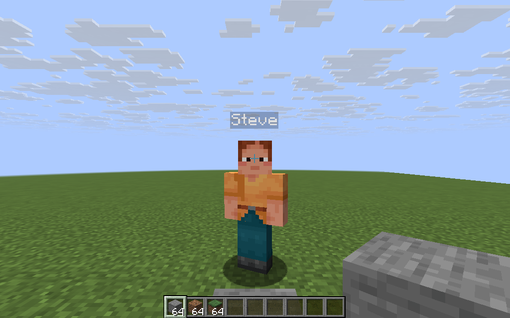
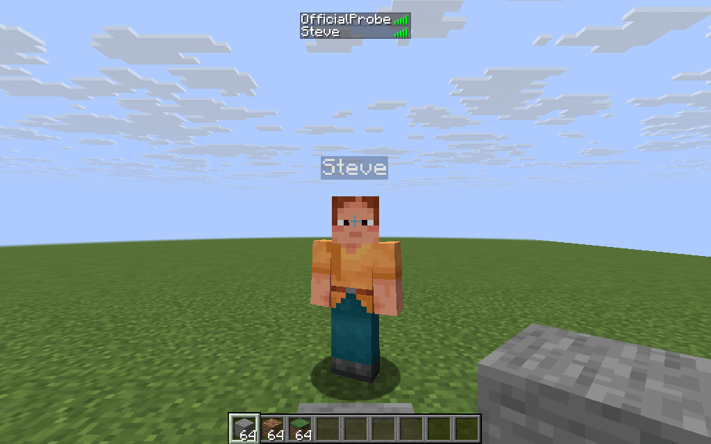
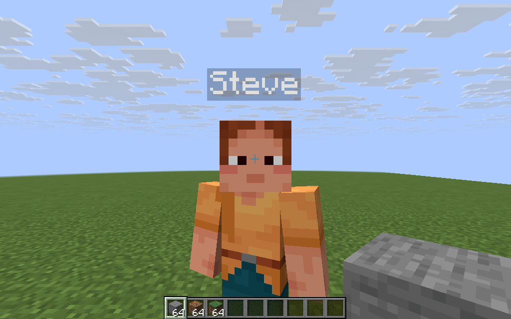
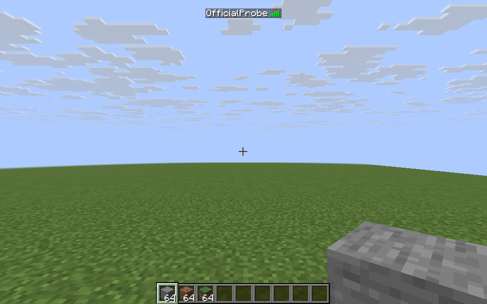

# Cross-edition player visibility — 2026-11-16

Tested runtime source: `44a6a681cfade5a2e6aa2a183f788ac4e5980920`.
This extends the shared world; it does not establish full Minecraft compatibility.

## Actual stock Java game

Unmodified official Java **26.3**, protocol **777**, Linux/Xvfb with the stock
Vulkan renderer and Mesa lavapipe. Official client JAR SHA-1:
`e877b6a07acd633fb3bb475002175cec036e7b87`. No client mods, agents, injected
classes, rewritten assets or authentication credentials were used. Offline
`OfficialProbe` connected to loopback. This is not online authentication evidence.

The separately running Go/Pion native client joined over signed NetherNet,
received the Java peer and moved into view. The actual Java game rendered its
stock fallback avatar/name and both roster entries. Real W-key input moved the
Java player; the independent native client decoded positions from eye-offset
`[0.5,5.62,0.549]` through `[0.5,5.62,2.6448352]`. After the native peer closed,
the actual game removed its avatar and roster entry while remaining connected.
The server was then stopped through SIGINT for orderly world saving.

Raw, unedited captures:

All six capture hashes, executable hashes, native movement output, test results
and the integration-harness timing samples are in
[shared-peers-result.json](shared-peers-result.json). The local server executable
SHA-256 is `db3bbe212c43e201dc8782de7fca2fd2082a9f251354c308f6c8cf0edc8f8dff`.
The native probe is an independent headless implementation, **not the official
Windows Bedrock game**. Only the actual Java game supplied rendering evidence.

## Independent validation

Linux Clippy and **134 project tests**, the ownership compile-fail doctest and
**256 vendor tests** pass. The Python/Go peer check validates both pose directions,
native player-list/skin/spawn decoding, exact current late-join positions and
entity-before-roster removal. A Korean/emoji native name uses the bounded Java
ASCII profile fallback while preserving the original display text.

An early native spawn failed independent decoding because a padded empty-hand
payload was interpreted as shield data by a minimal-registry client. Empty air
now carries an empty user-data buffer. The regression check independently decodes
the whole player packet, including the reused authoritative base ability layer.

Owner/projection tests cover atomic snapshots with their continuation, pending
and retired leases, self/duplicate/private-event rejection, and loaded-chunk
exit/re-entry. Block/input fixtures distinguish public presence from authoritative
block responses. Independent model tests retain strict private actor-ID checks.
Existing Java, NetherNet, aiortc, gameplay, forms, sounds, models, packs/cache,
consent keepalive, persistence and graceful-shutdown checks pass.

Timing records measure the **entire debug integration harness**, including Rust
startup, Python/Go voxel decoding and local transports, with a GUI game also
running. They are not server TPS, player latency, memory usage or scalability
results. No performance-support claim is inferred from the player limit.

## Scope

Java uses its stock default skin; native peers use original green placeholder
geometry/skin. Account skins/capes/persona, equipment and swings, combat, player
collision and general entity simulation are pending. Public hosting, official
Windows Bedrock entry/rendering and online authentication remain unverified.
[Owner/wire contract and reproduction](../peers.md).

Native Windows [run 43816295927](https://github.com/SKYRPG8957/Sculith/actions/runs/43816295927)
passes at the exact source above, including the new peer lifecycle check and all
existing runtime/interop/pack/plugin/package/launcher checks. The inspected archive
has **24 members**, **6,591,847 bytes**, SHA-256
`b3e53d511f6613f52c1e2df5492ac9e3b974e4151e3f0b3eec02199d751c7175`.
All five EXEs import system DLLs only. The nine authored pack files match source
(JSON with checkout CRLF/LF normalization; PNG/OGG byte-identical); locked metadata,
license and source revision match. No keys, worlds, game JARs or test clients are
included. Public download and installation validation are pending.

