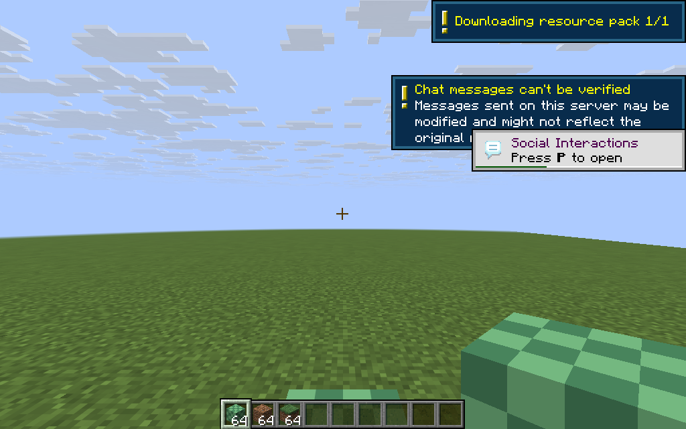

# Shared sound verification — 2026-11-16 UTC

Scope: the current local offline preview, Java 26.3/protocol 777, native protocol
2225, one region owner. The user is away; no manual user retest is assumed.

The unmodified official Java game loads the generated required pack, enters and
renders the world, and plays the original custom tone requested by the actual
Rust sound example. OpenAL Soft's built-in Wave File Writer provides real client
PCM output without game mods or an attached sound device. The client JAR remains
SHA-1 `e877b6a07acd633fb3bb475002175cec036e7b87`.

The first capture is stereo PCM16 at 48 kHz. The strongest one-second window has
an FFT peak at **880 Hz**, with **99.8059%** of windowed spectral energy in
875–885 Hz. This demonstrates actual client pack/audio decoding and mixing; it
does not mean a human heard sound through speakers. The exact-source capture at `e3fe40318a496da96f22a7c9d0ce4b46cab5eaaa`
has a peak at **880 Hz** and **99.7221%** energy in that band. It contains
192,512 stereo PCM frames. PCM SHA-256:
`2d800ea06dcd1880bd5fd3a6ffe2aead6fd75276eb9a7907c3b221eec19604cd`.
[Machine-readable record](shared-sound-result.json) includes the raw capture hash,
format and FFT method. The raw device file was snapshotted while running, with
OpenAL's unknown-length RIFF/data size sentinels; analysis uses the actual complete
frames. No resampling, signal generation or replacement audio is used as client
evidence. Temporary game/cache/audio/log files are not shipped.

The screenshot is an unmodified root-window capture. Its SHA-256 is
`f4fe183fff86f7532f576635ca664be7907be15564801084410c06af9766f7b6`.
The existing [actual-game setup record](2026-11-16-java26.3.md) documents the pinned
official JAR/JRE and local rendering setup. For the audio scenario, enable master
sound, disable music, use the same content source with `sculith-sound-plugin`, and
select the stock OpenAL wave backend (`ALSOFT_DRIVERS=wave`, an `ALSOFT_CONF` file
with `[wave] file=/absolute/capture.wav`). Capture after the server logs pack load,
spawn acknowledgement and the Rust plugin's sound request. Format is 48 kHz,
stereo PCM16; calculate the Hann-windowed FFT of the strongest one-second window.
This is offline local testing, without a real account login. Unsupported online
account service calls are not treated as proof of online authentication.

`scripts/sound_smoke.py` passes against the built Linux executable and real Rust
plugin. Python independently checks the generated Java archive and wire packet;
Go/Pion receives the original native OGG and definition and decodes the latest
PlaySound layout. A Java mutation after native join verifies that the native
player's sound was not broadcast to Java. The test requires exact callback counts
and graceful plugin stopping. Unit tests reject unregistered sounds, malformed
identifiers, nonfinite/range-invalid parameters, pending/dead recipients, and rate
overflow, while preserving region revision and the game-hook stream.

Previously compiled v2 gameplay and v3 forms executables pass the new host; all
versions remain negotiated independently. Both texture delivery/cache and delayed
consent regressions pass. Native Windows [run 43801768939](https://github.com/SKYRPG8957/Sculith/actions/runs/43801768939)
passes at the same exact source: unit/vendor/Clippy/doctest, Java/native/WebRTC,
current plugins/forms/sounds, required pack/cache/consent, packaging and extracted
launchers. Linux CI runs 43801769062 and 43801764466 also pass.

Windows ZIP: **6,269,330 bytes**, SHA-256
`9d2e071f60a204df58ee0e1be6a2800b3ad945e48e5e9e4609c415a66291a5f5`.
Nineteen members, metadata, original clip and license texts were inspected. All
four EXEs import only Windows system DLLs; their sizes/hashes/imports are in the
JSON record. No private key, game JAR, world snapshot or test log is bundled.
The original MIT text is preserved (Windows checkout line endings differ).
[Publication run 43802965625](https://github.com/SKYRPG8957/Sculith/actions/runs/43802965625)
created public Preview 13 from this tested immutable build. A fresh unauthenticated
HTTPS ZIP/checksum download passes exact source/tag/SHA-256 verification. Current
installer/download defaults select Preview 13; native public installation is pending. Official Windows Bedrock GDK world entry and sound rendering
remain unverified: the available native test is an independent client, not the
official game.

A small-pack preparation measurement uses five fresh debug CLI processes, including
startup, file I/O, validation and both archive builds. The original source is five
files / 6,065 bytes; generated native/Java ZIPs are 6,798 / 7,191 bytes. Median wall
time is 4.586 ms and maximum child RSS is 16,288 KiB (`wait4`, Linux). This is not
a server memory, TPS or large-pack performance claim; individual samples are in
the JSON record.
